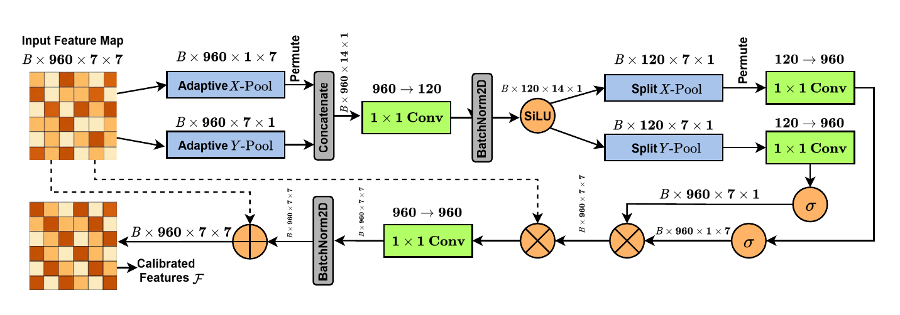
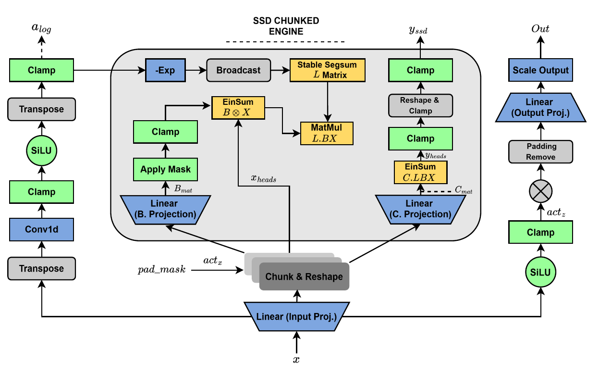
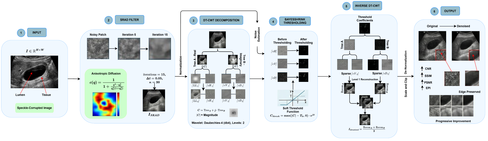

# CHASM

**Contiguous Hilbert Aggregated State-space Model for gallbladder ultrasound classification**

Official code and model repository for:

> **CHASM: Overcoming Spatial Disruption with Linear-Time Hilbert State-Space Modeling for Gallbladder Ultrasound Classification**  
> Mehedi Hasan Meraj, Mahmudul Hasan, Mashfiquzzaman Tajbid, Nafisa Tasneem Esha, Md Assaduzzaman, Nafiz Fahad, and Tze Hui Liew.

If you use CHASM, its source code, figures, or model weights, **please cite the CHASM paper**. A `CITATION.cff` file and BibTeX template are provided below.

## Architecture

.pdf)

CHASM combines a MobileNetV4-Conv-Small feature extractor with Coordinate-Aware Gating, four-direction Hilbert serialization, a shared state-space duality reasoning block, Scan-Aggregation Spatial Fusion, and Feature-Guided Aggregation. The 9-class model uses a 7×7 backbone feature map, 192-dimensional sequence features, four 49-token Hilbert scans, and a shared SSD block.

### Coordinate-Aware Gating



### Shared SSD reasoning engine



### SRAD + wavelet preprocessing



The vector PDF versions of all figures are included under `assets/`.

## Model weights

The CHASM model weights are included as:

```text
weights/CHASM.pth
```

SHA-256:

```text
8097f61e4bdf71ef08a9c7263de7ff7c52bcf3b76cd0f5e9a636e2f7d1256b94
```

The checkpoint contains the full backbone and CHASM weights, so evaluation does not require downloading ImageNet weights.

```bash
python scripts/verify_checkpoint.py --full-model
```

Core tensor dimensions:

- backbone output: `B × 960 × 7 × 7`
- projected feature map: `B × 192 × 7 × 7`
- each Hilbert sequence: `B × 49 × 192`
- positional embedding: `1 × 512 × 192`
- classifier output: `B × 9`

## Dataset

CHASM uses **UIdataGB**, a public multi-class gallbladder ultrasound dataset:

> Turki, A., Obaid, A. M., Bellaaj, H., Ksantini, M. & AlTaee, A. **UIdataGB: Multi-class ultrasound images dataset for gallbladder disease detection.** *Data in Brief* **54**, 110426 (2024).

Dataset record: **Mendeley Data DOI: 10.17632/r6h24d2d3y.2**

Please download UIdataGB from its official source. Dataset images are not redistributed in this repository.

Expected class folders:

```text
1Gallstones
2Abdomen and retroperitoneum
3cholecystitis
4Membranous and gangrenous cholecystitis
5Perforation
6Polyps and cholesterol crystals
7Adenomyomatosis
8Carcinoma
9Various causes of gallbladder wall thickening
```

## Installation

Python 3.10 is recommended.

```bash
git clone https://github.com/Meraj-coding21/CHASM-Linear-Time-Hilbert-State-Space-Model.git
cd CHASM-Linear-Time-Hilbert-State-Space-Model
python -m venv .venv
source .venv/bin/activate          # Windows: .venv\Scripts\activate
pip install --upgrade pip
pip install -r requirements.txt
```

## Leakage-safe perceptual-hash split

The repository includes a deterministic split generator that keeps perceptually similar images in the same partition.

The procedure:

1. Compute a 64-bit perceptual hash (pHash) for every raw image.
2. Group images whose pHash Hamming distance is within the configured threshold.
3. Keep every near-duplicate group within a single split.
4. Preserve class labels during assignment.
5. Verify that no duplicate group crosses train, validation, and test partitions.

Run:

```bash
python scripts/make_leakage_safe_split.py \
  --data-root /path/to/UIdataGB \
  --output-root data/raw_split \
  --phash-threshold 4 \
  --seed 42
```

Default split proportions are 75% train, 15% validation, and 10% test. The script also writes `split_manifest.csv` with image paths, pHash values, cluster IDs, and split assignments.

## Preprocessing

Apply the SRAD + wavelet preprocessing pipeline:

```bash
python scripts/preprocess_dataset.py \
  --input-root data/raw_split \
  --output-root data/preprocessed
```

The preprocessing pipeline uses SRAD followed by a two-tree `db4` wavelet construction, BayesShrink thresholding, low-frequency CLAHE, inverse reconstruction, and resizing.

## Evaluate CHASM

```bash
python scripts/evaluate.py \
  --data-root data/preprocessed \
  --checkpoint weights/CHASM.pth \
  --split test
```

Evaluation reports accuracy, macro precision, macro recall, macro F1, macro specificity, MCC, and Cohen's kappa.

Reported UIdataGB benchmark performance:

| Metric | CHASM |
|---|---:|
| Accuracy | 99.72% |
| Macro Precision | 99.75% |
| Macro Recall | 99.71% |
| Macro F1 | 99.73% |
| Macro Specificity | 99.96% |
| MCC | 99.68% |
| Cohen's kappa | 99.68% |

A newly generated split has different sample membership, so results from retraining on a new split should be reported as a separate experiment.

## Train CHASM

After splitting and preprocessing the dataset:

```bash
python scripts/train.py \
  --data-root data/preprocessed \
  --output CHASM_trained.pth \
  --seed 42
```

Training follows three stages: frozen backbone training, partial backbone unfreezing, and full convolutional-backbone fine-tuning. Auxiliary classifier heads are used during training and are not required for the final prediction output.

## Repository layout

```text
CHASM/
├── README.md
├── CITATION.cff
├── requirements.txt
├── chasm/
│   ├── constants.py
│   ├── data.py
│   ├── dedupe.py
│   ├── hilbert.py
│   ├── metrics.py
│   ├── model.py
│   └── preprocessing.py
├── scripts/
│   ├── make_leakage_safe_split.py
│   ├── preprocess_dataset.py
│   ├── train.py
│   ├── evaluate.py
│   └── verify_checkpoint.py
├── tests/
├── assets/
├── weights/
│   └── CHASM.pth
└── .github/workflows/ci.yml
```

## Tests

```bash
pytest -q
python scripts/verify_checkpoint.py --full-model
```

The tests cover Hilbert permutations, tensor shapes, pHash split isolation, positional-embedding dimensions, checkpoint structure, model loading, and a full forward pass.

## Citation

Please cite the CHASM paper if you use this repository.

```bibtex
@article{meraj2026chasm,
  title  = {CHASM: Overcoming Spatial Disruption with Linear-Time Hilbert State-Space Modeling for Gallbladder Ultrasound Classification},
  author = {Meraj, Mehedi Hasan and Hasan, Mahmudul and Tajbid, Mashfiquzzaman and Esha, Nafisa Tasneem and Assaduzzaman, Md and Fahad, Nafiz and Liew, Tze Hui},
  year   = {2026}
}
```

Update the citation with the final journal, volume, pages, and DOI when available.

## Intended use

This repository is provided for research on gallbladder ultrasound image classification. It is not a medical device and is not intended to replace clinical judgment.
